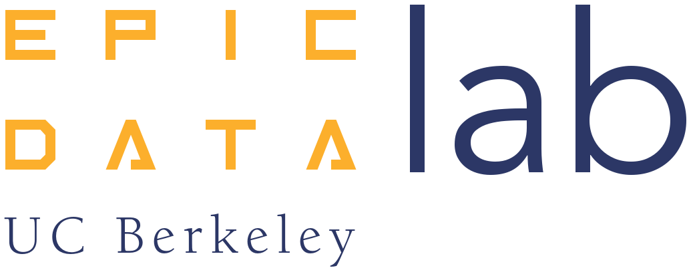
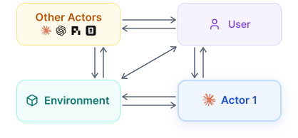
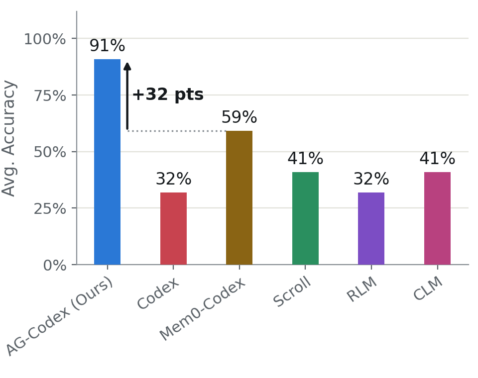
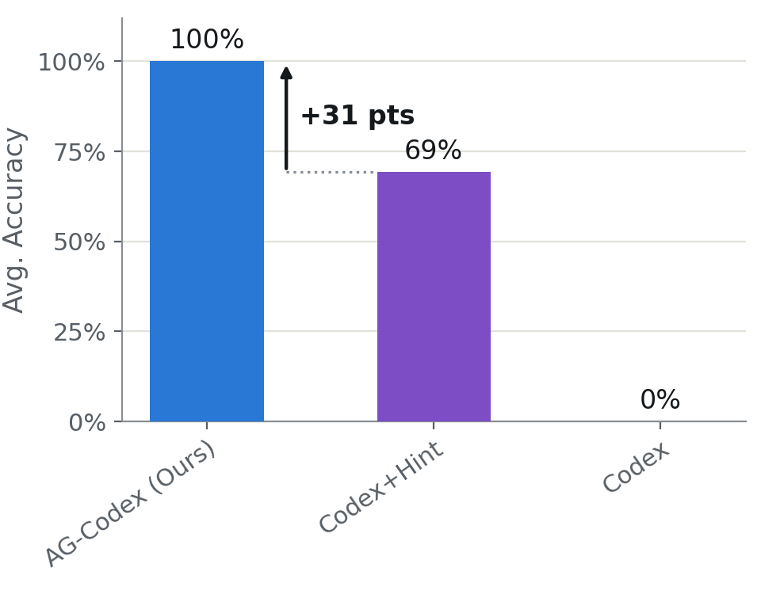
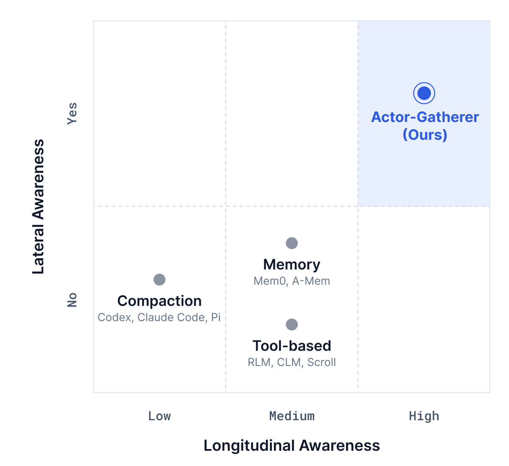
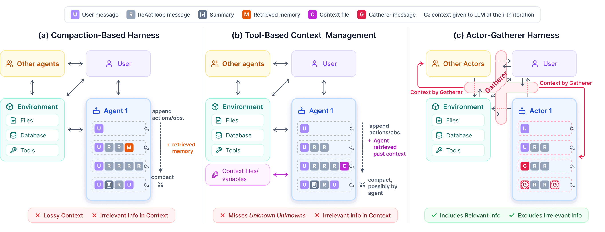
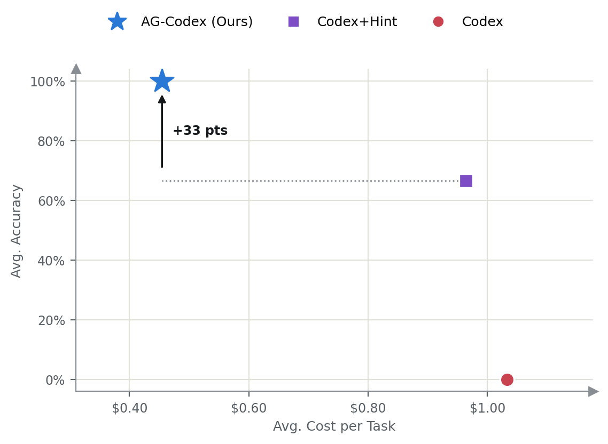
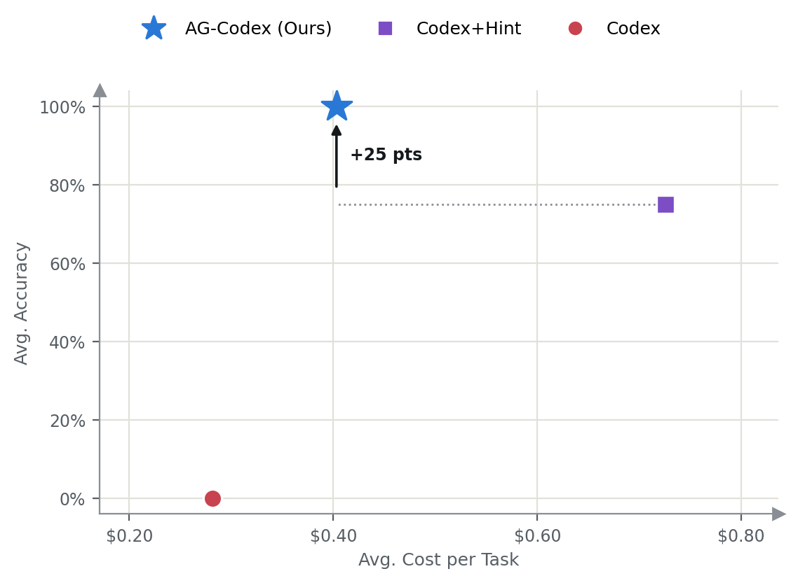
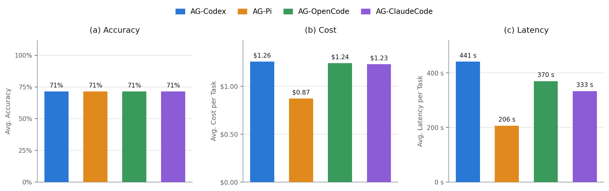
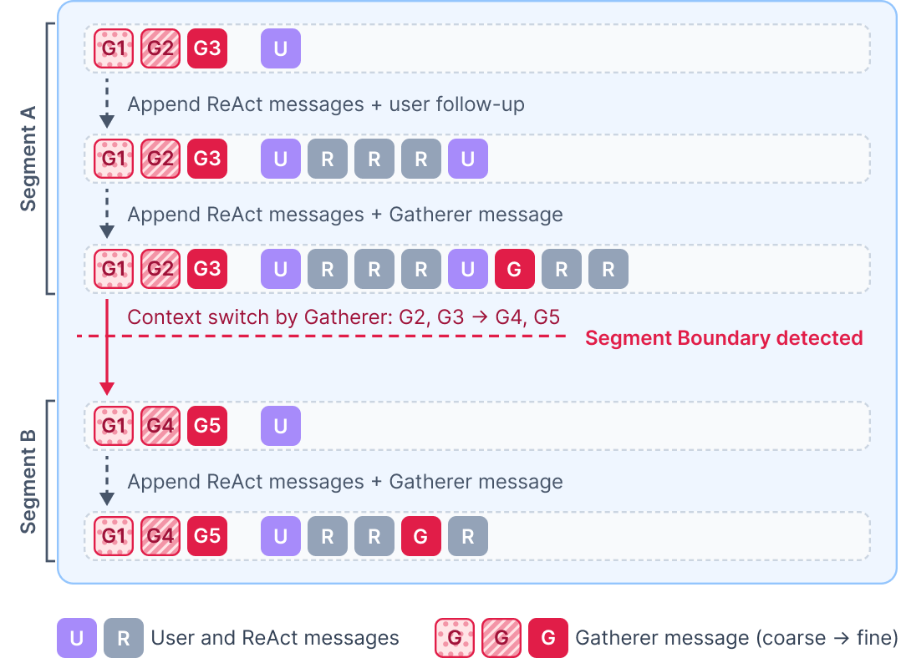

<!--
generated: pandoc html -> gfm from 2026-10-22-actor-gatherer-framework-blog.html; figures downloaded to 2026-10-22-actor-gatherer-framework-blog_images/
note: generated companion of the raw HTML, never hand-edited.
-->

☰

[Actor-Gatherer](./)

[Blog](./)[Docs](docs.html)[GitHub](https://github.com/ucbepic/actor-gatherer)

[Overview](#overview)

- [What is the Actor-Gatherer Framework?](#what-is)
- [How does it compare with existing context management methods?](#comparison)

[The Context Management Problem, Revisited](#problem)

[Why Existing Harnesses Fail](#why-fail)

[Bolt-On Actor-Gatherer Architecture](#architecture)

[Results](#results)

- [Single-agent comparison with baselines](#results-single)
- [Multi-agent environments](#results-multi)
- [Different harnesses](#results-harnesses)

[Context Management Details](#framework)

[Conclusion](#conclusion)

[References](#references)

# The Actor-Gatherer Framework for AI Agents

[Sepanta Zeighami](https://szeighami.github.io/), [Kerem Akillioglu](https://keremakillioglu.github.io/), [Asim Biswal](https://abiswal2001.github.io/),  
[Alvin Cheung](https://people.eecs.berkeley.edu/~akcheung/), [Joseph E. Gonzalez](https://people.eecs.berkeley.edu/~jegonzal/), [Aditya G. Parameswaran](https://people.eecs.berkeley.edu/~adityagp/)

  

TL;DR

- Actor-Gatherer is an open source bolt-on framework for context management across agents.
- Improves context management in long-running sessions, across agents working in parallel, and as the environment changes.
- Currently integrates with ![](data:image/svg+xml;base64,PHN2ZyB3aWR0aD0iMTQiIGhlaWdodD0iMTQiIHZpZXdib3g9IjAgMCAyNCAyNCIgYXJpYS1oaWRkZW49InRydWUiPjxwYXRoIGZpbGw9IiNEOTc3NTciIGQ9Im00LjcxNDQgMTUuOTU1NSA0LjcxNzQtMi42NDcxLjA3OS0uMjMwNy0uMDc5LS4xMjc1aC0uMjMwN2wtLjc4OTMtLjA0ODYtMi42OTU2LS4wNzI5LTIuMzM3NS0uMDk3MS0yLjI2NDYtLjEyMTQtLjU3MDctLjEyMTUtLjUzNDMtLjcwNDIuMDU0Ni0uMzUyMi40Nzk3LS4zMjE4LjY4Ni4wNjA4IDEuNTE3OS4xMDMyIDIuMjc2Ny4xNTc4IDEuNjUxNC4wOTcyIDIuNDQ2OC4yNTVoLjM4ODZsLjA1NDYtLjE1NzktLjEzMzYtLjA5NzEtLjEwMzItLjA5NzJMNi45NzMgOS44MzU2bC0yLjU1LTEuNjg3OS0xLjMzNTYtLjk3MTQtLjcyMjUtLjQ5MTgtLjM2NDMtLjQ2MTQtLjE1NzgtMS4wMDc4LjY1NTctLjcyMjUuODgwMy4wNjA3LjIyNDYuMDYwNy44OTI1LjY4NiAxLjkwNjQgMS40NzU0IDIuNDg5MyAxLjgzMzYuMzY0My4zMDM1LjE0NTctLjEwMzIuMDE4Mi0uMDcyOC0uMTY0LS4yNzMzLTEuMzUzOS0yLjQ0NjctMS40NDUtMi40ODkzLS42NDM1LTEuMDMyLS4xNy0uNjE5NGMtLjA2MDctLjI1NS0uMTAzMi0uNDY3NC0uMTAzMi0uNzI4NUw2LjI4Ny4xMzM1IDYuNjk5NyAwbC45OTU3LjEzMzYuNDE5LjM2NDIuNjE5MiAxLjQxNDcgMS4wMDE4IDIuMjI4MiAxLjU1NDMgMy4wMjk2LjQ1NTMuODk4NS4yNDI5LjgzMTguMDkxLjI1NWguMTU3OXYtLjE0NTdsLjEyNzUtMS43MDYuMjM2OC0yLjA5NDcuMjMwNy0yLjY5NTcuMDc4OS0uNzU4OS4zNzY0LS45MTA3Ljc0NjgtLjQ5MTguNTgyOC4yNzkzLjQ3OTcuNjg2LS4wNjY4LjQ0MzMtLjI4NTMgMS44NTE3LS41NTg2IDIuOTAyMS0uMzY0MyAxLjk0MjloLjIxMjVsLjI0MjktLjI0MjkuOTgzNS0xLjMwNTMgMS42NTE0LTIuMDY0My43Mjg2LS44MTk2Ljg1LS45MDQ2LjU0NjQtLjQzMTFoMS4wMzIxbC43NTkgMS4xMjkzLS4zNCAxLjE2NTctMS4wNjI1IDEuMzQ3OC0uODgwNCAxLjE0MTQtMS4yNjI4IDEuNy0uNzg5MyAxLjM2LjA3MjkuMTA5My4xODgyLS4wMTgzIDIuODUzNS0uNjA3IDEuNTQyMS0uMjc5NCAxLjgzOTYtLjMxNTcuODMxOC4zODg2LjA5MS4zOTQ2LS4zMjc4LjgwNzUtMS45NjcuNDg1Ny0yLjMwNzIuNDYxNC0zLjQzNjQuODEzNi0uMDQyNS4wMzA0LjA0ODYuMDYwNyAxLjU0ODIuMTQ1Ny42NjE4LjAzNjRoMS42MjFsMy4wMTc1LjIyNDcuNzg5Mi41MjIuNDczNi42Mzc2LS4wNzkuNDg1Ny0xLjIxNDIuNjE5My0xLjYzOTMtLjM4ODYtMy44MjUtLjkxMDctMS4zMTEzLS4zMjc5aC0uMTgyMnYuMTA5M2wxLjA5MjkgMS4wNjg2IDIuMDAzNSAxLjgwOTIgMi41MDc1IDIuMzMxNC4xMjc1LjU3NjgtLjMyMTguNDU1NC0uMzQtLjA0ODYtMi4yMDM5LTEuNjU3NS0uODUtLjc0NjgtMS45MjQ2LTEuNjIxaC0uMTI3NXYuMTdsLjQ0MzIuNjQ5NiAyLjM0MzYgMy41MjE0LjEyMTQgMS4wODA3LS4xNy4zNTIxLS42MDcxLjIxMjUtLjY2NzktLjEyMTQtMS4zNzIxLTEuOTI0NkwxNC4zOCAxNy45NTlsLTEuMTQxNC0xLjk0MjgtLjEzOTcuMDc5LS42NzQgNy4yNTUyLS4zMTU2LjM3MDMtLjcyODYuMjc5My0uNjA3MS0uNDYxNC0uMzIxOC0uNzQ2OC4zMjE4LTEuNDc1My4zODg2LTEuOTI0Ni4zMTU3LTEuNTMuMjg1My0xLjkwMDQuMTctLjYzMTQtLjAxMjEtLjA0MjUtLjEzOTcuMDE4Mi0xLjQzMjggMS45NjcyLTIuMTc5NiAyLjk0NDYtMS43MjQzIDEuODQ1Ni0uNDEyOC4xNjQtLjcxNjQtLjM3MDQuMDY2Ny0uNjYxOC40MDA4LS41ODg5IDIuMzg2LTMuMDM1NyAxLjQzODktMS44ODIuOTI5LTEuMDg2OC0uMDA2Mi0uMTU3OWgtLjA1NDZsLTYuMzM4NSA0LjExNjQtMS4xMjkzLjE0NTctLjQ4NTctLjQ1NTQuMDYwOC0uNzQ2Ny4yMzA3LS4yNDI5IDEuOTA2NC0xLjMxMTRaIj48L3BhdGg+PC9zdmc+)Claude Code, ![](data:image/svg+xml;base64,PHN2ZyB3aWR0aD0iMTQiIGhlaWdodD0iMTQiIHZpZXdib3g9IjAgMCAyNCAyNCIgYXJpYS1oaWRkZW49InRydWUiPjxwYXRoIGZpbGw9ImN1cnJlbnRDb2xvciIgZD0iTTIyLjI4MTkgOS44MjExYTUuOTg0NyA1Ljk4NDcgMCAwIDAtLjUxNTctNC45MTA4IDYuMDQ2MiA2LjA0NjIgMCAwIDAtNi41MDk4LTIuOUE2LjA2NTEgNi4wNjUxIDAgMCAwIDQuOTgwNyA0LjE4MThhNS45ODQ3IDUuOTg0NyAwIDAgMC0zLjk5NzcgMi45IDYuMDQ2MiA2LjA0NjIgMCAwIDAgLjc0MjcgNy4wOTY2IDUuOTggNS45OCAwIDAgMCAuNTExIDQuOTEwNyA2LjA1MSA2LjA1MSAwIDAgMCA2LjUxNDYgMi45MDAxQTUuOTg0NyA1Ljk4NDcgMCAwIDAgMTMuMjU5OSAyNGE2LjA1NTcgNi4wNTU3IDAgMCAwIDUuNzcxOC00LjIwNTggNS45ODk0IDUuOTg5NCAwIDAgMCAzLjk5NzctMi45MDAxIDYuMDU1NyA2LjA1NTcgMCAwIDAtLjc0NzUtNy4wNzI5em0tOS4wMjIgMTIuNjA4MWE0LjQ3NTUgNC40NzU1IDAgMCAxLTIuODc2NC0xLjA0MDhsLjE0MTktLjA4MDQgNC43NzgzLTIuNzU4MmEuNzk0OC43OTQ4IDAgMCAwIC4zOTI3LS42ODEzdi02LjczNjlsMi4wMiAxLjE2ODZhLjA3MS4wNzEgMCAwIDEgLjAzOC4wNTJ2NS41ODI2YTQuNTA0IDQuNTA0IDAgMCAxLTQuNDk0NSA0LjQ5NDR6bS05LjY2MDctNC4xMjU0YTQuNDcwOCA0LjQ3MDggMCAwIDEtLjUzNDYtMy4wMTM3bC4xNDIuMDg1MiA0Ljc4MyAyLjc1ODJhLjc3MTIuNzcxMiAwIDAgMCAuNzgwNiAwbDUuODQyOC0zLjM2ODV2Mi4zMzI0YS4wODA0LjA4MDQgMCAwIDEtLjAzMzIuMDYxNUw5Ljc0IDE5Ljk1MDJhNC40OTkyIDQuNDk5MiAwIDAgMS02LjE0MDgtMS42NDY0ek0yLjM0MDggNy44OTU2YTQuNDg1IDQuNDg1IDAgMCAxIDIuMzY1NS0xLjk3MjhWMTEuNmEuNzY2NC43NjY0IDAgMCAwIC4zODc5LjY3NjVsNS44MTQ0IDMuMzU0My0yLjAyMDEgMS4xNjg1YS4wNzU3LjA3NTcgMCAwIDEtLjA3MSAwbC00LjgzMDMtMi43ODY1QTQuNTA0IDQuNTA0IDAgMCAxIDIuMzQwOCA3Ljg3MnptMTYuNTk2MyAzLjg1NThMMTMuMTAzOCA4LjM2NCAxNS4xMTkyIDcuMmEuMDc1Ny4wNzU3IDAgMCAxIC4wNzEgMGw0LjgzMDMgMi43OTEzYTQuNDk0NCA0LjQ5NDQgMCAwIDEtLjY3NjUgOC4xMDQydi01LjY3NzJhLjc5Ljc5IDAgMCAwLS40MDctLjY2N3ptMi4wMTA3LTMuMDIzMWwtLjE0Mi0uMDg1Mi00Ljc3MzUtMi43ODE4YS43NzU5Ljc3NTkgMCAwIDAtLjc4NTQgMEw5LjQwOSA5LjIyOTdWNi44OTc0YS4wNjYyLjA2NjIgMCAwIDEgLjAyODQtLjA2MTVsNC44MzAzLTIuNzg2NmE0LjQ5OTIgNC40OTkyIDAgMCAxIDYuNjgwMiA0LjY2ek04LjMwNjUgMTIuODYzbC0yLjAyLTEuMTYzOGEuMDgwNC4wODA0IDAgMCAxLS4wMzgtLjA1NjdWNi4wNzQyYTQuNDk5MiA0LjQ5OTIgMCAwIDEgNy4zNzU3LTMuNDUzN2wtLjE0Mi4wODA1TDguNzA0IDUuNDU5YS43OTQ4Ljc5NDggMCAwIDAtLjM5MjcuNjgxM3ptMS4wOTc2LTIuMzY1NGwyLjYwMi0xLjQ5OTggMi42MDY5IDEuNDk5OHYyLjk5OTRsLTIuNTk3NCAxLjQ5OTctMi42MDY3LTEuNDk5N1oiPjwvcGF0aD48L3N2Zz4=)Codex, Pi and OpenCode.
- [**+32%** higher accuracy over state-of-the-art for a long-running single agent, and **+31%** with parallel agents and in a changing environment.](#comparison)

[Code →](https://github.com/ucbepic/actor-gatherer)[Docs →](docs.html)

## Overview

### What is the Actor-Gatherer Framework?

Users perform interrelated tasks (e.g., build different, but related features on a code base) using agents over long running sessions, often also using multiple agents in parallel. Multiple long running sessions create a large amount of evolving historical data that new tasks depend on. This data is often too large to fit in typical LLM context windows, and a context management layer decides what information goes in the LLM’s context.

Actor-Gatherer is a new paradigm in agent design where the **context across agents is managed proactively and externally**. Actor-Gatherer separates solving a task from context management needed to do so. An **Actor** agent is responsible for performing the user-specified tasks, while a **Gatherer** component observes the Actor agent, as well as other agents and the environment, and decides what context should be provided to the Actor agent. So, the Gatherer decides the context both based on the Actor’s task and actions, as well as any relevant external event, such as other Actors changing a relevant file. Actor-Gatherer is particularly useful for context management in long-running sessions, sharing context across sessions and agents, and in changing environments (e.g., working in parallel with agents).

We design a bolt-on framework to turn any existing coding agent into one that uses the Actor-Gatherer framework: different agents from different harnesses connect to a common Gatherer component (a single Gatherer across agents), that, before every LLM call, sets its context based on the collective past history of all the agents, any parallel actions performed by the user, or any other relevant information available in the environment. **We have currently built integrations for Claude Code, Codex, OpenCode and Pi, and are actively expanding the set of integrations.**

‹

›

### How does it compare with existing context management methods?

Existing techniques either rely on summarization, e.g., Codex includes a summary of the history in context, which is lossy and therefore ineffective. Or they rely on tool-based access, e.g., Recursive Language Models or Context Language Models, where the agent itself can search the history using tools. However, this approach relies on agents knowing what information to search for in the first place, causing errors with ***unknown unknowns***: when an agent is missing key information but is unaware that it is missing it. In the Actor-Gatherer framework, the Gatherer proactively looks at the history, other agents and the environment based on the task at hand and finds any such information.

We evaluated the Actor-Gatherer framework across coding and data analysis tasks, using it for context management of Codex agents, referred to as AG-Codex. Fig. 1 shows the results in single-agent settings, where relevant context must include information from past interactions with the same agent. Fig. 2 shows the results when multiple agents perform tasks in parallel, so relevant context must include information from interactions with other agents or changes in the environment. Results show **more than 30% improvement in accuracy at lower cost** compared to the second-best approach.

Fig. 1. Single-agent results across coding and data analysis tasks

Fig. 2. Results in multi-agent settings

The Actor-Gatherer framework’s key improvements in accuracy come from better *longitudinal (1) and lateral awareness (2, 3):* (1) doing a better job identifying relevant context in long-running sessions (2) identifying relevant context from other parallel agentic sessions (3) identifying changes in the environment that may be pertinent to the current agentic tasks. Doing (1)-(3) requires us to separate the Gatherer from the Actor so that the Actor can be responsible for reasoning and execution, while the Gatherer is responsible for proactive context management and maintenance. We separate the “thinking” from the “remembering”.

## The Context Management Problem, Revisited

Users work with agents on interconnected tasks (e.g., developing multiple related features within the same codebase) over extended sessions, often performing several tasks with agents in parallel. New tasks users specify can depend—explicitly or implicitly—on the users’ prior and parallel interaction with the agents and the environment. Thus, to correctly perform a task, agents need to understand the past and parallel interactions between the user, agents, and the environment (e.g., files, databases, available tools). For example, a feature a user has built in the past or is building in parallel, or a data cleaning operation they specified in the past, may be implicitly needed for a future task, but an agent unaware of such history may not use them and perform the task incorrectly. Users may additionally interact with the environment themselves, e.g., modify files outside of their interaction with agents, which causes errors if agents are unaware of them. Thus, agents need *longitudinal awareness* of past user interactions with the agent itself (i.e., the history of the current active session), as well as *lateral awareness* of the user’s simultaneous interactions with other agents and changes in the environment that may pertain to the task at hand.

The amount of available lateral and longitudinal information grows over time and through parallel interactions with the system. However, LLMs have a bounded context window, and agentic harnesses decide what, among all possible information, should be provided to the LLM. As Fig. 3 shows, existing harnesses provide an insufficient view of the lateral and longitudinal information, so agents in existing harnesses lack both longitudinal and lateral awareness.

Fig. 3. Information captured by existing harnesses.

## Why Existing Harnesses Fail

As Fig. 4 (a) shows, in typical coding harnesses, such as Codex or Claude Code, agents passively rely on lossy summaries of past interactions with the user, which often miss relevant longitudinal information. Meanwhile, their context often contains the detailed trajectory (i.e., LLM tool calls and outputs) of more recent interactions, which can be redundant (e.g., the user may have switched to a different, unrelated task) and thus incur unnecessary cost. Moreover, agents are not provided any lateral information (either about other agents or changes to the environment), which causes errors even in simple scenarios; for example, an agent may not become aware of a file change and incorrectly rely on its old value. Memory-based approaches complement such coding harnesses by appending additional summaries (called *memories*) of the past to the context, retrieved (e.g., through embedding similarity) based on the user tasks \[[1](#ref-1), [2](#ref-2)\]. Such summaries are still lossy, and embedding-based retrieval can be inaccurate, thus providing limited improvement in longitudinal awareness.

Fig. 4. (a) Compaction-based context management, possibly augmented with memory. (b) Tool-based context management additionally allows tools to search/modify context. (c) The Actor-Gatherer harness uses a Gatherer component to store all relevant information and decides what to provide to the agent based on the task at hand.

More recent work, including Recursive Language Models (RLMs) and Context Language Models (CLMs), provides tools to the agents to manage their context \[[3](#ref-3), [4](#ref-4), [5](#ref-5), [6](#ref-6)\], e.g., to search past history or remove irrelevant information from their context, as shown in Fig. 4 (b). These tool-based approaches miss ***unknown unknowns***: context that an agent needs to perform the task but does not know is needed, coming from both past and parallel user interactions, or from changes in the environment. For example, the user may have previously asked to ensure the code stays compatible with Python 3.8, but an agent not given this information in context may not look for it at all and build an incompatible feature. Another example is when a user or a parallel agent changes a file the agent is using, and, unaware of the change, the agent may perform the task it’s given incorrectly. We also note that even when relevant information is found, tool-based context management approaches often also keep irrelevant information in context, which can both incur extra cost and cause inaccuracies. This is because retrieval is often imprecise, and harnesses may keep recent raw trajectory \[[5](#ref-5)\] or its metadata \[[4](#ref-4), [6](#ref-6)\] in context, which may not remain relevant for future tasks.

## Bolt-On Actor-Gatherer Architecture

We propose to rethink the architecture of agentic systems to enable full lateral and longitudinal awareness. Our key insight is that *context should be proactively constructed for a given task*; that is, the system should proactively decide, based on the task, agent actions and changes in the environment, what information should be provided to the agent to correctly perform the task. To do this, we introduce a **Gatherer** component, which is in charge of storing all relevant information and providing the context for agents that solve the task, called **Actors**. This approach decouples reasoning and acting from context management, allowing Actor agents to focus on performing the task while context management proactively decides what should be included in context, and removed, at any point during Actor reasoning.

Fig. 4 (c) shows how the Actor-Gatherer architecture differs from existing methods. It consists of a Gatherer component that gathers all relevant information, both from other agents and from the environment, in a shared data layer. Using this shared data layer, the Gatherer then uses LLMs, combined with other temporally-aware rules, to decide what information, and at what granularity, should be provided to the Actor when performing a given task. This approach improves accuracy, by better allocating limited context using LLM reasoning and utilizing all lateral and longitudinal information, and reduces cost by removing redundant information from the context.

A more detailed view of the architecture of agents following the Actor-Gatherer framework is shown in Fig. 5. A Gatherer component is a server that interacts with different Actors, potentially from different coding harnesses. Each Actor provides information to the Gatherer by calling the `insert` function in the Gatherer’s interface. When an Actor needs to perform an LLM call, it receives the LLM’s context from the Gatherer by calling the `get_context` function. The Gatherer separately defines pull-based streams to observe information from the environment through *pollers*, components that insert relevant information from the environment into the Gatherer. Inside the Gatherer, a context management policy decides, based on all available information (captured from all Actors and the environment), what context to return to the Actors. We discuss the Gatherer’s context management policy in [Context Management Details](#framework) below.

Fig. 5. Actor-Gatherer architecture.

## Results

We evaluated the Actor-Gatherer framework as a bolt-on framework used on top of Codex, Claude Code, Pi and OpenCode; AG-Codex refers to Actor-Gatherer used with Codex, and similarly for the other harnesses. We first present comparisons in single-agent settings, and then discuss settings where concurrent work occurs, including multiple agents or events that happen in the environment.

### Single-agent comparison with baselines

#### Setup

We compare AG-Codex with vanilla Codex, a memory-based baseline Mem0-Codex, which uses Mem0 \[[1](#ref-1)\] to augment Codex, and the more recent tool-based baselines RLM \[[4](#ref-4)\], CLM \[[5](#ref-5)\] and Scroll \[[6](#ref-6)\]. All of RLM, CLM and Scroll do variations of context offloading with tool-based access, where the agent’s context is stored in external variables or files that it can access if it needs more information. RLM and Scroll store context in variables, with different strategies for what is kept in context, while CLM stores context in a file that can be directly modified by the agent itself, giving the main agent the ability to remove information from its context. We use gemini-3.1-pro-preview as the model for agents, but generated histories with GPT-5.6-Terra to reduce cost. We evaluate three tasks:

*Coding.* We use a variation of SWE-bench to evaluate the coding ability of different methods when longitudinal awareness, i.e., knowledge of the past history of the agent, is needed. Specifically, we take tasks from SWE-bench, but remove part of the task specification and put it instead in a history which also includes other related and unrelated tasks. Each history is generated by running various coding and data analysis questions from different benchmarks; after generating the history, we plant the removed specification in it. Agents that do not obtain the specification from the history are likely to perform the task incorrectly.

*Data analysis.* We use a similar setup with the BirdInteract dataset. The history now includes planted information about which tables and columns to use, and how to use them, to perform certain tasks.

*Session analysis.* We evaluate how well the agent remembers the content of the history itself. The history contains past data analysis questions, based on Spider 2.0 results, and evaluation is done by asking about what was done in the history, e.g., “which questions discussed Africa”. Results are evaluated by the F1-score of the returned set.

#### Results

AG-Codex outperforms the baselines on all three tasks. On coding, RLMs perform poorly, as they often do not look for the specification in their history. Scroll performs better than RLM, as it maintains a summary of past actions that allows the agent to obtain the past specification. Codex frequently loses the specification during compaction, which is sometimes recovered by Mem0.

On data analysis, AG-Codex improves accuracy by 36 points over the best baseline, and all tool-based baselines perform significantly worse than on coding. The main challenge here is that agents often do not know that past information is needed and can be relevant, and often answer the question without looking at the history at all. Mem0, which automatically retrieves relevant information and includes it in context, performs better, as it sometimes correctly retrieves the needed information; failures occur when it either does not retrieve the relevant information or the relevant information is not included in its memories at all. On session analysis, the baselines perform worse on questions whose answers are harder to retrieve using keyword search or embeddings.

Single-agent results: accuracy vs. cost per task.

### Multi-agent environments

#### Setup

Here, we evaluate how well AG-Codex performs tasks in multi-agent environments. None of the baselines are designed to support settings where information needs to be shared across agents and/or from the environment, so we compare against vanilla Codex and Codex+Hint, which tells the agent that other agents may have relevant information and provides the path to the other agents’ traces for Codex to search. We evaluate two scenarios:

*Cross-session information sharing.* This scenario mirrors our data analysis setup, but instead of the required specification being in the agent’s own history, it is in another agent’s history.

*Environment changes.* AG-Codex is given simple coding and data analysis tasks, but while it is performing a task, required files get modified, either by other agents or by the user. The agent must then re-read the files and resolve any inconsistencies.

#### Results

Not surprisingly, Codex by default is unable to perform any of the cross-session tasks correctly, as it is unaware of other agents, and it also handles environment changes incorrectly. Codex+Hint gets some of the instances correct in both scenarios, but again misses information it doesn’t know to search for. AG-Codex correctly identifies relevant information from other agents’ history and accurately resolves changes in the environment. In cross-session sharing, both Codex variants are also more expensive: for tasks where they do realize they are missing information, they perform a more extensive search, reading either other agents’ traces or the files in the working directory. Similarly, under environment changes, reading through the traces of other agents working in parallel incurs additional cost for Codex+Hint.

Cross-session information sharing

Environment changes

Multi-agent results: accuracy vs. cost per task.

### Different harnesses

Finally, we compare using the Actor-Gatherer framework in different harnesses on the coding task discussed earlier, on top of Codex, Claude Code, Pi and OpenCode. Accuracy is similar across harnesses. AG-Pi was the fastest and cheapest in general, which we observed is because it performs less validation after it generates a first answer.

Actor-Gatherer across harnesses: accuracy, cost and latency per task.

## Context Management Details

Given the information stored in the Gatherer database, the context management policy decides, for every LLM call the harness makes, what context the LLM should be provided with. Identifying and including relevant information for a task is challenging for multiple reasons. As mentioned earlier, a major challenge is identifying unknown unknowns based on the given task. Identifying such information often requires reasoning over past traces and cannot be done with simple retrieval methods. Moreover, the method needs to balance cost/latency/accuracy trade-offs when deciding what context to provide to the LLM, and at what granularity. For example, changing the model context can invalidate the KV-cache, which can increase cost and latency, and is thus only worth doing when modifying the context is expected to improve accuracy. Similarly, spending more time identifying more relevant context worsens latency, which is only worth it if it is expected to improve accuracy.

Fig. 6. Proactive context management policy overview.

To balance cost/latency/accuracy trade-offs, we present a *segment*-based context management policy. We divide user interactions into *segments*, where a segment is a contiguous group of user and agent interactions that serve a single purpose. Within a segment, we only use an append-only context management policy; this keeps cost and latency low without sacrificing accuracy, since we expect the context needed within a segment to be similar. However, we perform *context switches* at segment boundaries, where a context switch modifies the context of the agent to both remove irrelevant information and bring in relevant information.

Fig. 6 illustrates this process. Within a segment, our append-only policy appends new tool calls, outputs and other messages to the context, similarly to existing policies in harnesses. Unlike existing harnesses, it may also include relevant concurrent events from other agents and the environment (e.g., file changes, or other agents performing a related task). During a context switch, on the other hand, the whole context may be modified. This is done with an LLM-based approach that reasons over the past history and trajectories of all the agents in the Gatherer database to decide what to include in the context, augmented by a temporal inductive bias that gives more weight to more recent observations. Finally, information is included in the context at varying degrees of granularity, depending on its importance and how frequently it may change. Information expected to remain relevant for more tasks is placed earlier in the context to maximize KV-cache reuse, while information expected to change more frequently is placed towards the end.

## Conclusion

Actor-Gatherer is an open source bolt-on framework for context management across any agents, with current integrations with Claude Code, Codex, Pi and OpenCode. It separating the Actor, which performs the task, from the Gatherer, which proactively decides the Actor's context from its history, other agents and the environment. This approach gives agents both longitudinal and lateral awareness. In single-agent settings, it improves basedlines accuracy by at least 27% on coding and 36% on data analysis tasks. With parallel agents and changes to the environment, It improves accuracy by 31% over baselines.

Try it out at [github.com/ucbepic/actor-gatherer](https://github.com/ucbepic/actor-gatherer).

## References

1.  P. Chhikara, D. Khant, S. Aryan, T. Singh, D. Yadav. [Mem0: Building Production-Ready AI Agents with Scalable Long-Term Memory](https://arxiv.org/abs/2504.19413). arXiv:2504.19413, 2025.
2.  W. Xu, Z. Liang, K. Mei, H. Gao, J. Tan, Y. Zhang. [A-MEM: Agentic Memory for LLM Agents](https://arxiv.org/abs/2502.12110). arXiv:2502.12110, 2025.
3.  C. Packer, S. Wooders, K. Lin, V. Fang, S. G. Patil, I. Stoica, J. E. Gonzalez. [MemGPT: Towards LLMs as Operating Systems](https://arxiv.org/abs/2310.08560). arXiv:2310.08560, 2023.
4.  A. L. Zhang, T. Kraska, O. Khattab. [Recursive Language Models](https://arxiv.org/abs/2512.24601). arXiv:2512.24601, 2026.
5.  R. Shao, S. Z. Shen, J. O. Yin, Y. Li, M. Wang, H. Ivison, R. Poovendran, N. Lambert, T. Xiao, M. Lewis, W. Yih, L. Zettlemoyer, P. W. Koh. [Context Language Models](https://arxiv.org/abs/2609.37725). arXiv:2609.37725, 2026.
6.  Y. Lin, E. Ang, E. Zhu, B. Ding, J. Zhou. [Context as an Environment: Programmatic Context Management for Long-Horizon Agents](https://arxiv.org/abs/2608.21690) (Scroll). arXiv:2608.21690, 2026.

Developed at the [EPIC Data Lab](https://epic.berkeley.edu/), UC Berkeley · [GitHub](https://github.com/ucbepic/actor-gatherer) · 2026
